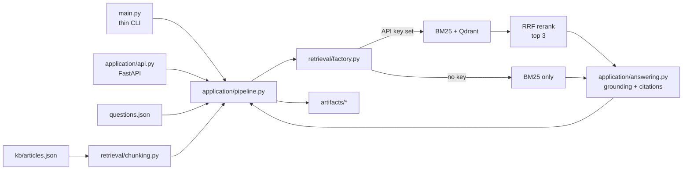

# Local AI Support Assistant

Local, grounded support Q&A with a FastAPI endpoint and a batch pipeline.

## Architecture



## Setup

```bash
uv sync
```

This creates `.venv`. BM25 mode works without an API key. To enable hybrid BM25 + OpenAI embeddings/Qdrant retrieval:

```bash
cp .env.example .env
# Set OPENAI_API_KEY in .env
uv sync --extra hybrid
```

`.env` and the local Qdrant index are git-ignored. `pyproject.toml` is the dependency source of truth; `requirements.txt` is retained for pip users.

## Batch pipeline

```bash
uv run python main.py
uv run python validate.py
```

The pipeline writes `index_preview.json`, `retrieval_results.json`, `answers.json`, `eval_summary.json`, and `run_log.jsonl` under `artifacts/`.

## FastAPI

Start the local server:

```bash
uv run hypercorn application.api:app --bind 127.0.0.1:8000
```

Ask a question:

```bash
curl -X POST http://127.0.0.1:8000/answer \
  -H 'Content-Type: application/json' \
  -d '{"question":"Are webhooks delivered exactly once?"}'
```

The response includes `question_id`, `answer`, `citations`, and `insufficient_context`.

## API evaluation

`eval_cases.json` covers supported paraphrases and unsupported questions. With the server running:

```bash
uv run python evaluate_api.py
```

The summary is written to `artifacts/api_eval_summary.json`. To exercise FastAPI in-process without opening a socket:

```bash
RETRIEVAL_FALLBACK_ON_ERROR=true uv run python evaluate_api.py --in-process
```

## Design notes

- With `OPENAI_API_KEY`, BM25 and Qdrant candidate rankings are fused with RRF. Without it, retrieval uses BM25 only.
- Qdrant runs locally under `artifacts/qdrant/`; its index is reused while the knowledge base and embedding model are unchanged. `kb/articles.json` remains the source of truth.
- OpenAI is used for embeddings only. Answers are deterministic and grounded in retrieved text; unsupported questions receive a safe refusal.
- `main.py` is a thin batch entry point. FastAPI, application services, and retrieval code live in separate modules.
