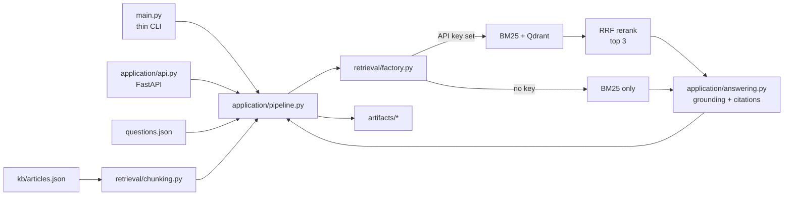

# Support Assistant Design

## Architecture

## Module ownership

- `main.py`: calls the batch pipeline; contains no business logic.
- `application/api.py`: FastAPI app and `/answer` route.
- `application/pipeline.py`: shared service used by API and CLI.
- `application/answering.py`: evidence checks, grounded answer, citation selection, refusal.
- `application/evaluation.py`, `application/artifacts.py`: sample checks and output files.
- `retrieval/chunking.py`: input validation and stable chunk IDs.
- `retrieval/bm25.py`: dependency-free lexical retrieval.
- `retrieval/hybrid.py`: OpenAI embeddings, local Qdrant, and RRF.
- `retrieval/factory.py`: selects hybrid mode or BM25-only mode.

## Retrieval and storage

- `kb/articles.json` is the source of truth.
- Chunks preserve `chunk_id`, `article_id`, `title`, `product`, and `text`.
- With a key, embed chunks once, store vectors and chunk payloads in `artifacts/qdrant/`, and reuse the index when the corpus/model fingerprint matches.
- For each question, retrieve candidates from BM25 and Qdrant, fuse ranks with equal-weight RRF, and return the top three.
- Without a key, build BM25 in memory and do not create a vector index.
- `.env` and `artifacts/qdrant/` are local-only and git-ignored. Never log the API key.

## Runtime

- Batch: `uv run python main.py`
- Validate: `uv run python validate.py`
- API: `uv run hypercorn application.api:app --bind 127.0.0.1:8000`
- Hybrid dependencies: `uv sync --extra hybrid`
