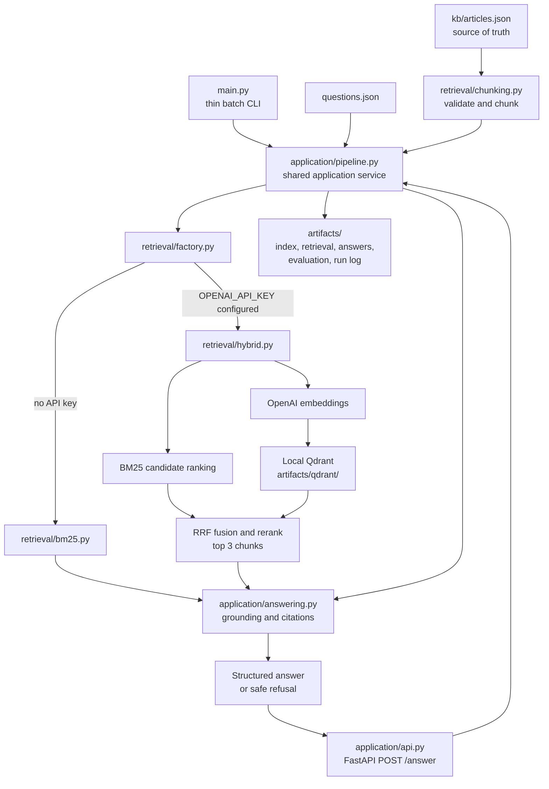

# Technical Specification: Grounded AI Support Assistant

## 1. Purpose

Define the implementation for a small local support assistant that answers questions from the supplied knowledge base, cites its sources, and declines when the retrieved material does not support an answer. The design separates the **application layer** (request flow, answer policy, evaluation, artifacts) from the **retrieval layer** (chunking, embeddings, Qdrant, and BM25 fallback).

## 2. Goals and non-goals

### Goals

- Load the local support articles and supplied questions from JSON.
- Chunk articles in code while preserving `id`, `title`, and `product` metadata.
- Retrieve the top three chunks in code for each question.
- Use BM25 and OpenAI embeddings with local Qdrant together when `OPENAI_API_KEY` is configured, then fuse and rerank their candidate lists.
- Use BM25 when the key is absent, so the project runs without credentials.
- Generate short JSON answers grounded only in retrieved content, with unique article citations.
- Refuse or escalate when evidence is missing or insufficient.
- Write the required artifacts and provide a one-command pipeline and validation command.
- Expose the same question-answering flow through a small local HTTP API.

### Non-goals

- No hosted database or external retrieval service.
- No required LLM call for answer generation. The baseline answerer is deterministic to keep the output auditable and the default run credential-free.
- No authentication, customer data store, conversation memory, or production deployment in this scope.
- Hosted deployment, authentication, and production-scale traffic handling are outside this local API scope.

## 3. Architecture overview

```text
```



The application layer is a FastAPI application and owns the user-facing answer contract, request validation, and safety decisions. The retrieval layer returns ranked chunk records and does not generate or rewrite answers. Both layers communicate through plain Python dictionaries or small dataclasses; no layer should depend on Qdrant-specific response types outside the retrieval implementation. The batch CLI and FastAPI routes both call the same application service. `main.py` contains only the CLI handoff and must remain a thin entry point.

## 4. Proposed module layout

```text
main.py                         # thin batch CLI entry point; calls application service
validate.py                     # artifact and contract validation
application/
  __init__.py
  api.py                        # FastAPI app, lifespan setup, and HTTP routes
  pipeline.py                   # shared one-question and batch application services
  answering.py                  # evidence checks, deterministic answer generation
  artifacts.py                  # JSON and JSONL artifact writers
  evaluation.py                 # sample expected-source and refusal checks
  schemas.py                    # Pydantic HTTP request/response models
retrieval/
  __init__.py
  chunking.py                   # article loading/chunk preparation
  bm25.py                       # dependency-free fallback implementation
  hybrid.py                     # OpenAI embeddings, local Qdrant, BM25 fusion/RRF
  factory.py                    # select hybrid or BM25-only mode
config.py                       # .env loading and workspace paths
kb/articles.json
questions.json
artifacts/                      # generated outputs and local Qdrant data
tests/                          # focused unit tests (recommended)
.env.example                    # documented optional settings; no secret value
.gitignore                      # ignores .env and generated local database files
pyproject.toml                  # uv project metadata and dependencies
uv.lock                         # locked dependency versions
.python-version                 # Python version selected by uv
requirements.txt                # pip compatibility file
README.md
requirem.md                     # this specification
```

`main.py` is only the CLI entry point: load configuration, call the application pipeline, and report completion or errors. It must not contain chunking, retrieval, answer-generation, evaluation, artifact-writing, or API implementation logic. Those responsibilities belong in the modules above. The CLI and artifact formats remain stable during the split. The HTTP handler and CLI call the same application service so their answer policy, retrieval behavior, and response schema stay aligned.

## 5. Data contracts

### 5.1 Article input

`kb/articles.json` is an array of records with `id`, `title`, `product`, and `content`. All four fields are required strings. Article IDs are unique.

### 5.2 Retrieval chunk

```json
{
  "chunk_id": "ART-101-C1",
  "article_id": "ART-101",
  "title": "Password reset flow",
  "product": "Account",
  "text": "..."
}
```

`chunk_id` is stable for a given article and chunk order. Every chunk retains the source metadata needed for citations and display.

### 5.3 Retriever interface

The application layer calls a common interface:

```python
class Retriever(Protocol):
    mode: str  # "hybrid_qdrant_bm25" or "bm25"
    def index(self, chunks: list[Chunk]) -> None: ...
    def search(self, question: str, limit: int = 3) -> list[RetrievedChunk]: ...
```

`RetrievedChunk` contains `chunk_id`, `article_id`, and a numeric relevance `score`. In hybrid mode the score is the fused RRF score; in no-key mode it is the BM25 score. The application resolves these IDs to canonical chunk records. Results are ordered from most to least relevant and contain at most three items.

### 5.4 Answer output

```json
{
  "question_id": "Q1",
  "answer": "Use the latest reset link; it is valid for 15 minutes.",
  "citations": ["ART-101"],
  "insufficient_context": false
}
```

`citations` contains unique IDs from the loaded article set. A refusal has `insufficient_context: true`, a short safe message, and no citations unless a cited source explicitly supports the escalation instruction.

## 6. Retrieval layer design

### 6.1 Chunk preparation

The chunker accepts article records and returns retrieval chunks. The initial default can preserve each short sample article as one chunk, but it must still execute chunking logic. For larger articles, use deterministic sentence or word-boundary splitting with a configurable maximum size and small overlap. Chunk IDs use `<article_id>-C<n>`.

The chunker is independent of the vector store. It can be tested without OpenAI or Qdrant.

### 6.2 Hybrid path: embeddings, Qdrant, and BM25

When `OPENAI_API_KEY` is non-empty, use both semantic and lexical retrieval for every query:

1. Create embeddings for all chunk texts using `OPENAI_EMBEDDING_MODEL` (default: `text-embedding-3-small`). Include title/product text alongside body text to improve retrieval context.
2. Create a local Qdrant collection with cosine distance and a vector size inferred from the embedding response.
3. Upsert vectors with payload fields `chunk_id` and `article_id` (metadata can be included for inspection).
4. For each question, run BM25 over all chunks and query Qdrant with the question embedding. Each retriever returns a candidate pool of up to 10 chunks (or all chunks when the corpus is smaller).
5. Merge candidates by `chunk_id` and rerank the union using Reciprocal Rank Fusion (RRF), with equal weight for the BM25 and Qdrant rankings and a configurable RRF constant (default `k=60`). Do not combine the raw BM25 and cosine similarity scores directly.
6. Return the top three fused results as normalized `RetrievedChunk` values. The public `score` is the RRF score; hide backend-specific responses from application code.

RRF score for a chunk is `sum(1 / (k + rank))` across each retriever where it appears; ranks are one-based. A chunk missing from one candidate list contributes zero from that list. Sort by fused score descending, then by BM25 rank, then by `chunk_id` for deterministic tie-breaking. The sample corpus is small, so re-embedding and rebuilding the local collection for a batch run is acceptable initially. A later optimization can cache the index by a content hash. Local Qdrant files are generated state and must be git-ignored.

### 6.3 No-key path: BM25 only

When `OPENAI_API_KEY` is missing or blank, use a dependency-free BM25 implementation over chunk title, product, and text. It returns the same retrieval result shape and up to three entries. The answerer must ignore zero-score results as evidence.

The mode is selected once at pipeline startup and recorded in logs. This path must not attempt network access.

### 6.4 Provider and runtime errors

- Missing API key: select BM25-only mode.
- OpenAI/Qdrant package unavailable while a key is configured: fail with a clear setup message rather than silently reporting hybrid mode.
- Embedding or Qdrant runtime error: surface the error and exit non-zero by default. An optional `RETRIEVAL_FALLBACK_ON_ERROR=true` setting may permit BM25-only fallback; if enabled, record the switch per run and in output metadata/logs.
- In hybrid mode, combine ranked positions with RRF; never add or directly compare raw BM25 scores and cosine similarity scores.

## 7. Application layer design

### 7.1 Pipeline orchestration

The application pipeline:

1. Loads and validates articles and questions.
2. Calls the retrieval layer to chunk/index once, then retrieve and rerank candidates for each question (hybrid RRF when a key is configured; BM25-only otherwise), returning up to three chunks.
3. Persists the index preview and retrieval results.
4. Passes only the retrieved text and associated metadata to the answer component.
5. Applies support checks and constructs the structured answer.
6. Writes answers, evaluation summary, and JSONL run log.

The retrieval implementation must not select answer text or citations. The application layer owns citation selection and refusal behavior.

### 7.2 Grounded answer generation

Initial implementation uses deterministic generation. It can select or compose concise statements from the retrieved text. Any generated clause must be traceable to one or more retrieved chunks. Citations are the distinct `article_id` values from chunks that support the final answer, not simply every retrieved result.

Before answering, require evidence relevance. At minimum:

- Ignore chunks with zero or invalid scores.
- Require meaningful lexical/semantic alignment between the question and supporting chunk.
- Require the supporting text to contain the fact needed for the answer.
- Do not infer sensitive details, policy exceptions, contacts, identities, or next steps absent from the knowledge base.

If support checks fail, return `insufficient_context: true` and a neutral message such as: “I couldn’t find that information in the available support articles. Please contact support for help.”

An optional answer LLM can be considered later. If introduced, it must receive only retrieved context, be instructed not to use outside knowledge, emit the answer schema, and pass the same citation and support validation as deterministic answers. API availability must not remove the no-key execution path.

### 7.5 Local HTTP API

The core application is implemented with FastAPI. It exposes:

```http
POST /answer
Content-Type: application/json

{"question": "Are webhooks delivered exactly once?"}
```

The response uses the answer fields from the batch output, with a generated `question_id` when one is needed:

```json
{
  "answer": "No. Webhooks are delivered at least once, so duplicates are possible.",
  "citations": ["ART-302"],
  "insufficient_context": false
}
```

FastAPI initializes the retriever and knowledge-base index once in its application lifespan, then routes call the shared answer service for each request. It validates that `question` is a non-empty string and returns a client error for malformed input. Retrieval/provider failures return a clear server error without exposing credentials or stack traces. It binds to localhost by default; production deployment and authentication are out of scope.

### 7.3 Citation and output cleanup

- Deduplicate citation IDs while preserving order.
- Reject or remove citations not found in the loaded article set.
- Do not include citations to retrieved chunks that did not support the answer.
- Enforce exact required output keys and types before writing JSON.

### 7.4 Evaluation

The sample evaluation checks expected sources for Q1–Q4 and verifies Q5 is marked insufficient. The checks must use question IDs from the supplied sample for evaluation only; retrieval and answer logic must not depend on IDs or exact sample question strings. The summary contains an overall `passed` flag plus per-question checks.

## 8. Configuration and secrets

Configuration is read from the process environment, with optional `.env` loading for local development. Exported environment values take precedence over `.env` values.

| Variable | Default | Purpose |
|---|---|---|
| `OPENAI_API_KEY` | unset | Enables hybrid BM25 + OpenAI embeddings/Qdrant retrieval |
| `OPENAI_EMBEDDING_MODEL` | `text-embedding-3-small` | Embedding model name |
| `QDRANT_PATH` | `artifacts/qdrant` | Local Qdrant persistence directory |
| `RETRIEVAL_FALLBACK_ON_ERROR` | `false` | Whether provider/runtime errors can switch to BM25 |

`.env` is local-only and ignored by Git. Commit `.env.example` with empty placeholders; never commit or log API key values.

## 9. Artifacts and observability

The batch command generates:

- `artifacts/index_preview.json`: all normalized chunks.
- `artifacts/retrieval_results.json`: question, question ID, and top-three chunk IDs/article IDs/scores.
- `artifacts/answers.json`: structured answer records.
- `artifacts/eval_summary.json`: sample evaluation results.
- `artifacts/run_log.jsonl`: one record per question with retrieved chunk IDs, retrieval mode (`hybrid_qdrant_bm25` or `bm25`), fallback flag, and ISO-8601 UTC timestamp.

Generated artifacts should be reproducible for the BM25 path except for timestamps. Do not log prompts containing secrets or include API keys in artifacts.

## 10. CLI and validation

### Run

```bash
uv sync
uv run python main.py
```

`uv sync` creates `.venv`. Install hybrid dependencies with `uv sync --extra hybrid`. The run command loads `.env`, selects hybrid retrieval when the key and optional dependencies are configured or BM25-only otherwise, and regenerates artifacts.

### Local API

Start the FastAPI application with:

```bash
uv run hypercorn application.api:app --bind 127.0.0.1:8000
```

FastAPI supports `POST /answer` with a JSON body containing a question string. `main.py` remains a thin batch CLI. FastAPI, Hypercorn, and the OpenAI client are core dependencies in `pyproject.toml`; Qdrant is in the `hybrid` optional dependency group.

### Validate

```bash
uv run python validate.py
```

Validation checks:

- Required input and artifact files exist and parse as JSON (or JSONL for the run log).
- Required fields and field types are present in every answer and retrieval record.
- Every citation refers to a known article and is unique within its answer.
- The top-three retrieval limit is respected.
- Q5 has `insufficient_context: true`.
- Evaluation summary passes all expected sample checks.
- The local API starts and `POST /answer` returns a schema-valid grounded answer for a supported question and a safe refusal for an unsupported one.

Validation errors should identify the failing file, question, or field and exit non-zero.

## 11. Testing strategy

Recommended focused tests:

- Chunking preserves article metadata and creates deterministic IDs.
- BM25 retrieves ART-101 for a password reset paraphrase.
- Retriever implementations return a common result schema and at most three hits.
- Unsupported CEO contact request is refused even if a weak lexical match is returned.
- Citation IDs are unique and valid.
- Sample evaluation passes for Q1–Q5.

BM25 and application tests should not need network access. Qdrant/OpenAI integration should be covered with mocked provider calls; a live API smoke test is optional and must not be required for CI or clean-checkout validation.

## 12. Acceptance criteria

1. `uv sync` creates `.venv`; `uv run python main.py` succeeds with no `.env` and no API key, using BM25-only retrieval.
2. With configured dependencies and `OPENAI_API_KEY`, each query uses both BM25 and Qdrant, then merges/reranks their candidates with RRF.
3. Hybrid and BM25-only modes return the same public retrieval record shape and top-three limit.
4. Supported sample questions receive grounded answers with expected article citations.
5. Q5 is refused with `insufficient_context: true` and no fabricated contact details.
6. All required artifacts are regenerated, and `python validate.py` passes.
7. `.env` and the local Qdrant database are excluded from version control.
8. The local API answers a single question using the configured retrieval backend and the same grounding policy as batch mode.

## 13. Implementation plan

### Phase 1 — Establish module boundaries and contracts

**Work**

- Create `application/` and `retrieval/` Python packages.
- Keep `main.py` as a thin entry point only; do not add pipeline/business logic there.
- Move chunk records, retrieved chunk records, question inputs, and answer outputs into shared typed structures in `application/schemas.py` or a dependency-neutral `shared/` module.
- Define the retriever protocol: build/load the index once, then search a question for up to three normalized results.
- Keep `main.py` as a thin batch CLI that calls the application service.
- Preserve the JSON artifact shapes defined in this spec.

**Exit criteria**

- Application code has no imports from Qdrant SDK types.
- CLI can load inputs and call a stub/mock retriever through the shared interface.

### Phase 2 — Build chunking and BM25 retrieval

**Work**

- Move article validation and deterministic chunking to `retrieval/chunking.py`.
- Preserve `article_id`, `title`, and `product`; generate stable `<article_id>-C<n>` IDs.
- Move the dependency-free BM25 code to `retrieval/bm25.py`.
- Ensure BM25 indexes article title, product, and chunk text and returns a normalized ranked list.
- Add offline tests for metadata preservation, stable chunk IDs, and password-reset retrieval.

**Exit criteria**

- BM25 returns up to three hits with the shared result shape.
- No API key, OpenAI package, or Qdrant package is needed for this phase or the default run.

### Phase 3 — Add local Qdrant persistence and hybrid reranking

**Work**

- Add embedding and local Qdrant behavior in `retrieval/hybrid.py`.
- Store vectors and chunk payload (`chunk_id`, `article_id`, title, product, and text) under `artifacts/qdrant/`; keep `kb/articles.json` as the source of truth.
- Create a local manifest containing the knowledge-base/chunking fingerprint and embedding model name. Reuse the collection when the manifest matches; rebuild it when inputs or model change.
- On each question, fetch up to 10 candidates from BM25 and up to 10 from Qdrant, merge by `chunk_id`, and rerank using equal-weight RRF. Return the top three fused hits.
- Select hybrid mode when `OPENAI_API_KEY` is configured; select BM25-only mode otherwise.
- Initialize the index once for a batch run or API process, never once per question.
- Keep `.env` and local Qdrant files out of version control. Document that article text and questions are sent to the configured embedding provider in hybrid mode.

**Exit criteria**

- Both modes satisfy the same retriever interface and return the same shape.
- Hybrid score is RRF, not a direct sum/comparison of BM25 and cosine scores.
- An unchanged local corpus reuses the persisted collection; a changed corpus or model triggers a rebuild.
- Provider failures follow the configured fail/fallback policy and are logged without exposing secrets.

### Phase 4 — Implement application answers and batch artifacts

**Work**

- Move orchestration into `application/pipeline.py` and deterministic grounded answering into `application/answering.py`.
- Pass only the top-three retrieved chunk text to the answerer.
- Require supporting evidence before answering; refuse when evidence is weak, absent, or unrelated.
- Derive citations only from chunks supporting the final answer, deduplicate them, and check IDs against the loaded article set.
- Generate `index_preview.json`, `retrieval_results.json`, `answers.json`, `eval_summary.json`, and `run_log.jsonl`.
- Record retrieval mode (`hybrid_qdrant_bm25` or `bm25`) in each run-log record.
- Add offline tests for unsupported CEO-contact questions, unique citations, and expected source articles for Q1–Q4.

**Exit criteria**

- `uv run python main.py` works from a clean checkout without `.env` and regenerates all required artifacts.
- Sample evaluation passes and Q5 has `insufficient_context: true`.
- Unsupported results contain no invented facts and no irrelevant citations.

### Phase 5 — Add the local HTTP API

**Work**

- Add `application/api.py` with `POST /answer` accepting `{"question": "..."}`.
- Initialize the application service and retrieval index once on server startup.
- Call the same answer service used by the batch CLI; keep answer and citation rules identical.
- Validate request shape and non-empty question; return a client error for invalid input and a safe server error for provider/storage failures.
- Use FastAPI as the required application framework, bind to `127.0.0.1` by default, and add FastAPI/Hypercorn dependencies and README instructions.

**Exit criteria**

- A supported request returns a grounded answer with citations.
- An unsupported request returns `insufficient_context: true`.
- The API works in BM25-only mode without credentials and hybrid mode when configured.

### Phase 6 — Validation, documentation, and completion review

**Work**

- Extend `validate.py` to check inputs, generated JSON and JSONL, required fields/types, citation validity/uniqueness, top-three retrieval limits, sample evaluation, and unsupported Q5 behavior.
- Update README run, validation, API, `.env`, embedding-provider, persistence, and `uv` environment instructions.
- Verify both configurations: no API key (BM25-only) and configured hybrid retrieval (using mocks if a live key is unavailable).
- Confirm generated Qdrant files and `.env` are ignored by Git.

**Exit criteria**

- `uv run python main.py` and `uv run python validate.py` pass in the no-key configuration.
- Offline tests pass; hybrid integration tests do not require a live key in CI.
- `uv.lock` is committed so clean installs use the resolved dependency set.
- All acceptance criteria in Section 12 are met.

## 14. Decisions and remaining choices

- **Answer generation:** deterministic and grounded by default. An answer-generation LLM is a later change and must pass the same evidence and citation checks.
- **Retrieval on startup:** reuse the local Qdrant collection when its knowledge-base/chunking fingerprint and embedding model match; otherwise rebuild once.
- **Provider failure:** fail clearly by default. An explicit fallback setting may switch the run to BM25-only mode and must be recorded.
